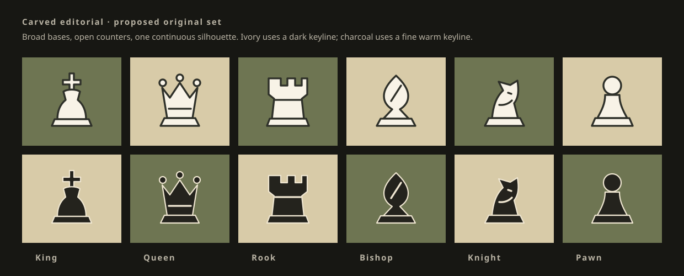
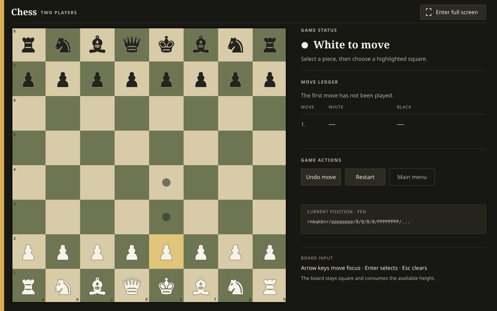
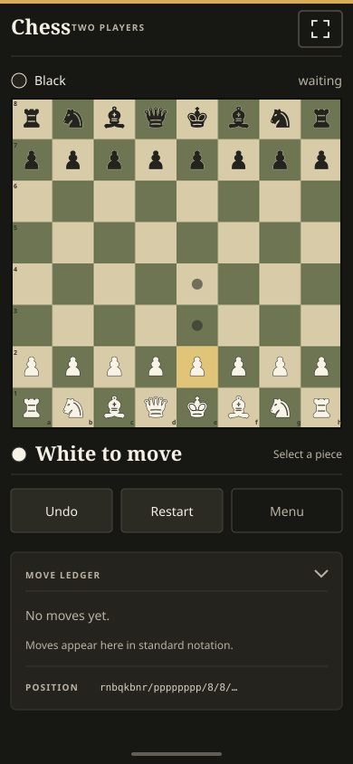

# Chess Web App: Full-Screen UI/UX Redesign Plan

**Status:** Planning only. No application code was changed.

## Recommended direction

Redesign the app as a **quiet, tactile, precise tournament table**. The board becomes the dominant object and expands to the largest square the viewport can hold. Supporting information behaves like a score sheet: a narrow ledger beside the board in landscape and a compact section below it in portrait.

“Full screen” will include both meanings:

1. **Always-on viewport layout:** every screen fills the browser viewport edge to edge, uses `100dvh` with safe fallbacks, removes arbitrary max-width margins from game play, and sizes the board from the actual remaining width and height.
2. **Optional browser Fullscreen API control:** an explicit “Enter full screen” button requests browser fullscreen after a user gesture. The button changes to “Exit full screen,” native Esc remains authoritative, and the control is omitted when the API is unavailable.

This is the chosen approach, not an unresolved product decision. The viewport-filling layout delivers the benefit everywhere, including browsers that limit the Fullscreen API. The optional toggle is useful for focused play on desktop and Android without making it a prerequisite. The app must never enter browser fullscreen automatically.

## Design brief

### Audience and context

- **Casual local players** sharing one laptop, tablet, or phone. They need a clear board, obvious turn state, and quick undo/restart controls.
- **Solo players** playing Stockfish. They need to know whose turn it is, whether the engine is working, and why input is temporarily unavailable.
- **Chess learners and composers** building positions. They need an efficient piece palette, understandable validation, and reliable FEN tools.
- Sessions are anonymous, local, and often short. The existing promise that no account, server, or runtime network is required should remain visible without dominating play.

### Primary task by screen

- **Start:** choose a game mode.
- **Computer setup:** choose side and difficulty, then start.
- **Two-player game:** read the position and make the next move.
- **Computer game:** make the next legal move and understand engine state.
- **Custom position:** construct a valid position and start it.

The board is the primary content on game and setup screens. Status and controls support it rather than enclosing it in another decorative card.

### Personality

- **Quiet:** warm near-black, restrained borders, no glow or decorative gradient.
- **Tactile:** board colors and piece forms draw from wood, felt, ink, and carved tournament pieces.
- **Precise:** score-sheet typography, aligned move columns, explicit state language, and crisp focus treatment.

### Constraints and conventions to preserve

- Vite 6, React 18, strict TypeScript, Vitest, React Testing Library.
- No router and no backend. `App.tsx` owns the current screen.
- `chess.js` remains the sole rules authority; Stockfish remains in the existing worker architecture.
- Hooks own state; presentational components forward actions.
- The board remains a hand-built semantic grid with click-to-move and drag support.
- Preserve stable test and accessibility contracts where possible: `role="grid"`, “Chess board,” 64 gridcells, `data-testid="square-{id}"`, `data-piece`, semantic form controls, and existing action names.
- Do not add a UI library, icon package, or CSS framework. The design is small enough for existing React and CSS. Custom icons and pieces should be inline SVG.
- Keep runtime offline. Fonts should be self-hosted rather than loaded from a CDN.

## What was audited

### Verified directly

- Read `package.json`, `index.html`, `public/favicon.svg`, `src/index.css`, `src/main.tsx`, `src/App.tsx`, all five screen components, all listed UI components, the three hooks, the README, and the three UI test files.
- Ran `npm test`: **30 files and 366 tests passed**.
- Ran `npx tsc --noEmit`: **passed**.
- Confirmed exact dependencies: React/React DOM 18.3.1, `chess.js` 1.4.0, Stockfish 19.0.1; no component or CSS library.

### Not verified in this planning step

- No browser screenshot or assistive-technology session was performed. Visual findings below are inferred from the rendered structure and CSS.
- `npm run build` was intentionally not run. Its `prebuild` copies engine files into `public/engine/` and Vite writes `dist/`; this planning step was only allowed to create files in this plan folder.
- Full accessibility compliance cannot be claimed from static review and automated tests. The implementation needs manual keyboard, zoom, screen reader, touch, and contrast checks.

## Current UI audit

### App shell and global styling

Current styling is a compact dark UI built from one large `src/index.css`. The palette is slate/blue, the body adds a radial background gradient, most content is centered within fixed `max-width` containers, and the default typeface is the system sans stack.

Problems:

- The game container stops at `68rem`; the board stops at `34rem`. Wide and tall displays leave substantial unused space.
- The layout uses `min-height: 100vh`, not `100dvh`, and does not account for mobile browser chrome or safe-area insets.
- The game grid collapses at one width breakpoint but does not reason about available height or portrait/landscape orientation.
- The system font, slate panels, rounded cards, blue accent, radial gradient, and pills resemble a generic app shell rather than a chess table.
- Global focus-visible styling is absent. Browser defaults may be inconsistent or low contrast.
- There is no shared app header or Fullscreen API support.
- Motion reduction only slows the spinner; it should stop nonessential animation rather than merely lengthening it.

### Start screen (`StartScreen.tsx`)

Current appearance and behavior:

- Centered “Chess” heading, technical subtitle, then three vertically stacked rounded mode cards.
- Each mode is a full-width button with title and description. Unavailable modes can show a “Coming soon” pill, although all three modes are currently enabled.

Problems:

- The technical implementation copy (“chess.js,” “No account, no server, no cost”) appears before the primary choice and does not answer “what do I want to play?”
- Centered heading plus stacked floating cards is generic and does not establish a distinct chess identity.
- The screen does not fill or compose around the viewport; large screens become a narrow column in empty space.
- Hover exists, but there is no authored `:focus-visible` or active state.

### Computer setup (`ComputerSetupScreen.tsx`)

Current appearance and behavior:

- A centered `34rem` form with two rounded fieldsets.
- Native radio inputs choose White, Black, or Random and one of four difficulty presets. Medium and White are defaults.
- Every difficulty includes blurb, skill, depth, and maximum time. Start and Back sit at the bottom.

Problems:

- The engine implementation paragraph is more prominent than the decision itself.
- Difficulty rows have useful detail but poor scan hierarchy; “skill/depth” is developer-facing and can confuse casual players.
- Color and difficulty choices look like the same generic option cards.
- The selected state relies heavily on a blue border. It needs a clear check/radio marker and text emphasis.
- The narrow column wastes desktop width and gives no preview of the chosen side.

### Shared game view (`GameView.tsx`, `GameScreen.tsx`, `ComputerGameScreen.tsx`)

Current appearance and behavior:

- Header shows a small title, turn pill, and optional engine spinner.
- Main area uses a board on the left and an `18rem` rounded side panel containing controls, opponent details, moves, and FEN.
- Below `54rem`, the panel stacks under the board.
- Computer mode orients the board to the player, locks all square buttons while the engine moves, shows a dismissible error notice, and explains the engine preset.

Problems:

- The `34rem` board cap makes the most important content too small on desktop.
- The board aligns to the left of an elastic column rather than being deliberately centered in its available stage.
- The title and turn pill duplicate attention; current player identity is reduced to a colored dot.
- Controls have equal visual weight. Restart and Main menu can destroy progress without confirmation.
- FEN is always exposed despite being specialist information. It competes with move history.
- Computer thinking empties the status container when idle, which reserves unclear blank space. While thinking, native `disabled` on all squares removes them from keyboard focus and makes the board harder to inspect.
- Engine failure can be dismissed but offers no concrete recovery path such as “Try again” or “Play two-player.”
- Mobile order places all supporting content below the board with no compact information strategy.

### Board and squares (`Board.tsx`, `Square.tsx`)

Current appearance and behavior:

- An 8×8 CSS grid with wrapper `gridcell` elements and a button inside every cell.
- Click-to-move is primary. HTML drag-and-drop is optional.
- Selection is a yellow inset outline; legal quiet moves are dots; captures are rings; last move is a translucent yellow wash; check uses a red radial gradient.
- Coordinates are tiny labels inside edge squares.
- Every square has an accessible label such as “e4, empty.”

Problems:

- Every one of the 64 square buttons is tabbable. Keyboard users must traverse the entire board to reach the next control.
- There are no arrow-key grid controls, roving tab index, Home/End behavior, or keyboard instructions.
- A selected square, legal target, last move, and check are mostly communicated by color/shape visually but not consistently exposed as state descriptions to assistive technology.
- `disabled` suppresses all interaction and focus during engine turns; `aria-disabled` plus guarded actions would preserve inspection.
- HTML drag-and-drop is unreliable on touch devices. Click/tap-to-move must remain first-class.
- At 320px, a fully visible 8×8 board can only provide 40px squares, below the required 44px touch target.
- The current check radial gradient and multiple translucent overlays can muddy the piece silhouette.
- Coordinates may be difficult to read at small sizes and need orientation-aware contrast.

### Pieces (`Piece.tsx`)

Current appearance and behavior:

- Uses solid Unicode chess characters for both colors.
- Fill and text-shadow distinguish white and black pieces.

Problems:

- Shape depends on the operating system’s fallback font, so proportions and quality vary by browser and platform.
- Text shadows become fuzzy at small sizes and on lower-density screens.
- Unicode glyph metrics make vertical centering and drag feedback inconsistent.
- The pieces have no product-specific visual identity.

### Turn, thinking, moves, and controls

- `TurnIndicator` is a live polite status with a white/black dot and optional red “Check” badge.
- `ThinkingIndicator` is another live status with a spinning ring.
- `MoveList` formats SAN into white/black columns and has a clear “No moves yet.” empty state.
- `GameControls` exposes Undo, Restart, and Main menu.

Problems:

- Two simultaneous polite live regions can generate redundant announcements.
- The app announces turn changes but not a complete move such as “Black played e5.”
- Move history does not automatically mark or scroll the latest move.
- The move list has a fixed `16rem` maximum rather than taking remaining viewport height.
- Undo wording does not explain the different computer behavior at the control itself.
- Controls lack icons, visible active feedback, and confirmation for destructive actions.

### Promotion and game-over dialogs

Current appearance and behavior:

- Promotion appears in a board overlay with four piece buttons and Cancel.
- Game over appears in a fixed modal with Play again and Main menu.
- Both have dialog semantics and `aria-modal`.

Problems:

- Neither implementation manages initial focus, traps focus, restores focus, or handles Escape explicitly.
- The promotion chooser is visually centered over the board instead of relating to the promotion file/rank.
- The game-over modal has no labelled description association.
- Background inertness is implied visually but not enforced for keyboard or assistive technology.

### Custom position editor (`SetupEditor.tsx`, `PiecePalette.tsx`)

Current appearance and behavior:

- Desktop places a `34rem` board beside a `22rem` vertical settings column. Mobile stacks them.
- The palette contains 12 piece buttons in one six-column grid and keeps counts.
- Side to move, castling, en passant, strict bishops, FEN copy/load, validation, and rule details are all exposed.
- Start is disabled until validation passes. Clipboard and malformed-FEN feedback use status/alert semantics.

Problems:

- A long stack of similar rounded fieldsets gives every setting equal importance and pushes validation far below the board.
- The palette mixes both colors in one 12-item sequence without strong grouping.
- “Nothing selected means click to delete” is efficient but risky and easy to forget. A visible Remove tool is clearer.
- Clear board is destructive and immediate.
- Validation is separated from the disabled Start action, so the reason may be off-screen.
- FEN is expert functionality but occupies a full fieldset in the primary flow.
- On small screens, repeated travel between palette, board, validation, and start is costly.
- Native drag remains secondary but lacks touch drag; tap placement is usable.

## Visual direction

### Typography

- **Display:** Fraunces, variable optical-size serif, used only for product name, screen title, turn statement, and game result. Its rounded old-style forms echo carved wood without looking ornamental. Self-host a restricted WOFF2 subset. Fraunces is distributed under the [SIL Open Font License 1.1](https://github.com/undercasetype/Fraunces/blob/master/OFL.txt).
- **Interface/body:** Source Sans 3, used for buttons, form controls, descriptions, and compact metadata. It was designed for UI legibility and is available from the [Adobe Source Sans repository](https://github.com/adobe-fonts/source-sans). Use the repository’s OFL-licensed files and retain the license text.
- **Notation/FEN:** `ui-monospace, "Cascadia Mono", "SFMono-Regular", Consolas, monospace`.
- Self-hosting preserves the app’s no-runtime-network property. Add `font-display: swap`; retain Georgia and system-sans fallbacks. Do not add a font npm package.

Type scale:

| Token | Size / line height | Use |
|---|---:|---|
| `--text-xs` | 0.75rem / 1.35 | coordinates, technical metadata |
| `--text-sm` | 0.875rem / 1.45 | secondary copy, move numbers |
| `--text-md` | 1rem / 1.5 | default body and controls |
| `--text-lg` | 1.25rem / 1.35 | section status |
| `--text-xl` | clamp(1.5rem, 2vw, 2rem) / 1.2 | screen titles |
| `--text-hero` | clamp(2.5rem, 7vw, 5.5rem) / 0.95 | start-screen wordmark only |

Keep body measure between 45 and 68 characters. Use weight and alignment before adding containers.

### Palette

The palette comes from tournament furniture: warm black lacquer, unbleached score paper, muted green baize, and brass clock hardware.

| Token | Hex | Purpose |
|---|---|---|
| `--ink-950` | `#171713` | page background and dark text |
| `--ink-900` | `#24231D` | raised work surface |
| `--ink-800` | `#2B2A23` | control fill |
| `--line` | `#3A3930` | structural rules |
| `--line-strong` | `#4B493E` | control outlines |
| `--paper-100` | `#F4F0E6` | primary text |
| `--paper-300` | `#D7D1C4` | secondary light text |
| `--muted` | `#B9B3A4` | secondary text |
| `--brass` | `#D8AD55` | primary action and brand rule |
| `--brass-bright` | `#E5C15E` | selected/focus outer ring |
| `--felt` | `#315F46` | success/valid state |
| `--clay` | `#C86B4A` | warning and last-move accent |
| `--danger` | `#A2332D` | check/error state |
| `--board-light` | `#D8CBA8` | light square |
| `--board-dark` | `#6E7552` | dark square |
| `--piece-white` | `#F8F3E7` | ivory piece fill |
| `--piece-black` | `#24231D` | charcoal piece fill |

Calculated WCAG contrast ratios:

- Primary text `#F4F0E6` on page `#171713`: **15.79:1**.
- Muted text `#B9B3A4` on page `#171713`: **8.60:1**.
- Primary text `#F4F0E6` on surface `#24231D`: **13.84:1**.
- Dark button text `#171713` on brass `#D8AD55`: **8.58:1**.
- White error text on danger `#A2332D`: **6.89:1**.
- Light text on success `#315F46`: **6.46:1**.
- Board light/dark difference: **3.01:1**, enough to separate adjacent non-text regions.
- Charcoal piece on light square: **11.04:1**; charcoal fill on dark square: **3.71:1**.
- Ivory piece on dark square: **4.38:1**. On light squares the ivory’s `#2E3029` keyline provides **8.29:1** separation. Charcoal pieces use an ivory keyline on dark squares, providing **3.91:1**.

State appearance must not rely on hue alone:

- **Selected:** 3px brass inner ring plus a 2px dark separation ring; `aria-selected="true"`.
- **Legal empty target:** dark centered dot with a light keyline; assistive description “legal destination.”
- **Legal capture:** four corner brackets rather than a circular wash; assistive description “legal capture.”
- **Last move:** two clay corner ticks on source and destination plus a low-opacity flat wash.
- **Check:** danger-colored corner brackets and a small “CHECK” status label outside the square. Avoid a radial gradient behind the king.
- **Keyboard focus:** 2px paper line plus 3px brass outer line, never suppressed by selection styling.
- **Drag over:** dashed paper inset line.

### Tokens

The implementation should consolidate tokens at the top of `src/index.css`:

```css
:root {
  --font-display: "Fraunces", Georgia, serif;
  --font-ui: "Source Sans 3", "Segoe UI", sans-serif;
  --font-mono: ui-monospace, "Cascadia Mono", Consolas, monospace;

  --space-1: 0.25rem;
  --space-2: 0.5rem;
  --space-3: 0.75rem;
  --space-4: 1rem;
  --space-5: 1.5rem;
  --space-6: 2rem;
  --space-7: 3rem;
  --space-8: 4.5rem;

  --radius-1: 0.25rem;
  --radius-2: 0.375rem;
  --radius-dialog: 0.75rem;

  --shadow-board: 0 12px 32px rgb(0 0 0 / 0.28);
  --shadow-dialog: 0 20px 56px rgb(0 0 0 / 0.42);

  --motion-fast: 120ms;
  --motion-ui: 180ms;
  --ease-out: cubic-bezier(.2, .8, .2, 1);
}
```

Use few, small radii. The board itself is square or at most `--radius-1`; side content uses rules and whitespace instead of a collection of floating cards. Shadows are reserved for the board and modal elevation, not every panel. There are no decorative gradients, glass blur, neon glow, gradient text, blobs, or scaling hover effects.

Content based on web sources was rephrased for compliance with licensing restrictions.

## Full-screen layout system

### App frame

- `html`, `body`, `#root` use `inline-size: 100%` and `min-block-size: 100%`.
- Every screen uses `min-block-size: 100vh; min-block-size: 100svh; min-block-size: 100dvh` in fallback order.
- Apply `env(safe-area-inset-*)` to the app frame. Use logical properties so portrait/landscape and future direction changes remain manageable.
- A slim shared top bar holds the product name, screen context, and fullscreen control. Game status remains adjacent to the board rather than turning the header into a toolbar.
- Prevent page-level horizontal overflow except for the explicit 320px board scroller described below.

### Game board sizing

Use a two-dimensional board stage rather than only `width: 100%`:

```text
landscape board size = min(
  available viewport height - top bar - player/status rows - vertical gutters,
  available viewport width - side ledger - horizontal gutters
)
```

Implementation strategy:

- `.game` is a full-height grid with rows `auto minmax(0, 1fr)`.
- `.game__layout` is a full-height grid with `minmax(0, 1fr)` for the board stage and `clamp(18rem, 25vw, 23rem)` for the ledger.
- `.game__board-stage` uses `container-type: size`, grid centering, and `min-block-size: 0`.
- `.board` uses `inline-size: min(100cqi, 100cqb); block-size: auto; aspect-ratio: 1`. Provide a viewport `min()` fallback for browsers without size container queries.
- Do not cap the board at `34rem`. On a 1440×900 viewport, the expected board is about 800px; on 375×844 it is about 351–366px depending on safe areas.
- The side ledger uses remaining height: fixed status/actions, then `minmax(8rem, 1fr)` for scrollable moves. FEN moves into a collapsed “Position details” disclosure.

### Responsive modes

- **Wide landscape (`min-width: 960px` and landscape):** board left, ledger right. The board consumes available height. Controls remain in the ledger.
- **Compact landscape (short height or 640–959px):** board remains left; ledger narrows and uses disclosures for engine details/FEN. Move list scrolls internally.
- **Portrait/tablet:** status above and below the board like player nameplates. Controls sit directly below. Move ledger follows and can collapse.
- **Mobile:** 12px outer gutter at 375px; no card around the board. The primary three controls remain visible and at least 44px tall. Less-used details sit in disclosures.
- **320–351px:** an 8×8 board cannot be fully visible and also provide 44×44px square targets. Preserve the 44px target requirement by setting a 352px minimum board and placing it in a labeled horizontal scroller, initially centered. Only 32px is clipped at 320px. Add subtle edge indicators and allow touch pan/keyboard scroll. Do not overlap hit targets. At 352px and above the board is fully visible.
- Use media queries for coarse composition and container queries for local typography/coordinates. Do not make orientation the only signal because split-screen desktop windows can be narrow and landscape.

### Fullscreen API control

- Add a text-and-icon button in the shared top bar. At mobile widths the visible label may collapse to the icon, but the accessible name remains “Enter full screen” or “Exit full screen.”
- Check `document.fullscreenEnabled` and that `document.documentElement.requestFullscreen` exists. If not, omit the control; do not show a permanently disabled action.
- Request fullscreen only inside the button click. Catch rejected promises and announce: “Full screen could not be opened. The game still fills this window.”
- Listen to `fullscreenchange` and derive state from `document.fullscreenElement`. This keeps the label accurate when native Esc exits.
- Do not intercept Esc merely to exit fullscreen; the browser owns that. Dialog Escape handling must not prevent native fullscreen exit.
- Clean up the listener on unmount. Never assume request success.
- Fullscreen targets `document.documentElement`, not only the board, so controls and status remain accessible.
- Keep the viewport-filling base layout unchanged when unsupported, including iOS/browser variants that do not expose the standard API.

## Piece redesign

### Direction: original “Carved Editorial” set

Use an original in-project vector set rather than importing an existing chess font or open piece library. This avoids attribution ambiguity and keeps visual control. The mock geometry created for this plan can be refined and released under the same license as the app.

[Open the proposed piece sheet](./pieces.svg)



The set uses:

- Broad, stable bases shared by all pieces.
- One continuous filled silhouette per piece, with only essential internal cuts.
- A slightly asymmetrical knight profile as the most characterful piece.
- Wide rook crenellations, an open queen crown, a short king cross, and a high-contrast bishop cut.
- Consistent visual weight: primary outlines scale around 3.2% of the 100-unit viewBox; black-piece keylines are thinner so they do not appear larger than ivory pieces.
- Occupancy of roughly 78% square height for major pieces and 70% for pawns, leaving room for state marks and coordinates.

Color differentiation:

- White: warm ivory fill `#F8F3E7` with dark `#2E3029` keyline.
- Black: charcoal fill `#24231D` with thin warm `#EFE6D1` keyline.
- Silhouettes are identical by type across colors. Fill, keyline, and board contrast do the differentiation; no glow or text shadow.

Rendering approach:

- Add a `ChessPieceSvg` component with a `viewBox="0 0 100 112"` and one path group per piece type.
- `Piece.tsx` continues to own `data-piece`, drag handlers, and `aria-hidden="true"`; it delegates drawing to `ChessPieceSvg`.
- Use `width: 82%; height: 82%` and `vector-effect="non-scaling-stroke"` where appropriate. SVG should use `currentColor`/CSS variables for fill and keyline.
- Keep pieces inline instead of using an external sprite `<use>` reference. Inline SVG is reliable under Vite subpath deployment, supports CSS state transitions, and avoids duplicate accessible names.
- Pieces remain hidden from the accessibility tree because each square already names its occupant.
- Verify every silhouette at 40, 44, 56, 72, and 96 CSS pixels, at 100% and 200% zoom, on both square colors. Ensure bishop cut, queen/king distinction, and knight direction remain legible.
- Use no morphing or bounce. A legal move may translate the piece for 120ms only if the interaction architecture can identify source and destination without delaying state; otherwise use an immediate update with a 120ms selection fade. Respect reduced motion.

The main-screen mocks use platform glyphs only as shorthand for board occupancy; `pieces.svg` is the authoritative piece direction.

## Main game mocks

### Landscape

[Open the landscape game mock](./game-landscape.svg)



Intent: the board uses almost the full available height. The right side reads as one score ledger separated by rules, not a stack of cards. Turn status is the strongest text after the board.

### Portrait/mobile

[Open the portrait game mock](./game-portrait.svg)



Intent: the board spans the useful width, player/status rows hug it, primary controls remain thumb-reachable, and the move ledger follows without covering the board.

## Screen and component redesign specifications

### Shared interaction system

All interactive elements:

- Minimum target size 44×44px, except the explicit narrow-board scroller still keeps each square 44×44px.
- Default: clear shape, label, and boundary where needed.
- Hover: change border/text/fill without scaling. Apply only under `(hover: hover)`.
- Focus-visible: 2px paper line and 3px brass outer ring with at least 2px offset where space permits.
- Active: 1px downward visual inset or darker fill for 80–120ms, no layout shift.
- Disabled: reduce contrast modestly, keep labels readable, set `cursor: not-allowed`, and explain disabled primary actions nearby.
- Loading: preserve control dimensions and update the label; use `aria-busy` where applicable.
- Motion uses opacity, color, and small translation only, 120–180ms. Under `prefers-reduced-motion: reduce`, remove transitions and spinner rotation; show a static thinking mark plus text.

### Start screen

Layout:

- Full-height asymmetric two-column composition on wide screens. Left third contains the Fraunces “Chess” wordmark, a short line (“Play here, with a friend or against Stockfish.”), and a subtle 4×4 board-edge motif built from flat CSS blocks.
- Right two-thirds contains three large mode rows divided by 1px rules. Each row has a sequence number, title, practical description, and arrow icon.
- On mobile, the wordmark occupies the top quarter and rows fill the remainder. Keep mode actions 72px or taller.

Copy:

- Keep tested mode names: “Two Players,” “Play vs Computer,” and “Custom Position.”
- Replace the technical subtitle with user-centered copy. Move “Runs locally. No account or server.” to a quiet footer note.
- Preserve “Coming soon” logic if a mode is disabled, but use plain inline text rather than a pill badge.

States:

- Hover draws a short brass rule from the left and increases title contrast.
- Focus-visible outlines the complete row.
- Active darkens the row; disabled includes “Unavailable” in accessible description.
- No entrance animation beyond an optional 120ms content fade; no stagger.

Accessibility:

- Keep a single `<main>` and `<h1>`.
- Buttons retain mode title in their accessible name. Arrow icons are hidden.
- Logical tab order matches visual mode order, then fullscreen.

### Computer setup screen

Layout:

- Wide screens use a two-column “match card”: left shows a small board preview/orientation diagram; right holds choices. This is a flat split surface with one rule, not floating cards.
- Color is a three-option segmented radio group with piece/board orientation preview.
- Difficulty becomes four ledger rows with plain-language labels first and technical values in a secondary disclosure or trailing column.
- Sticky bottom action row on short mobile screens, with Start primary and Back secondary.

Copy:

- Heading stays “Play vs Computer.”
- Intro: “Choose your side and how much time Stockfish gets to think. The engine runs on this device.”
- Difficulty blurbs should describe play behavior. Retain the existing accessible text containing “skill N · depth N” so current tests and expert users retain the detail.
- Dynamic side hint remains “You move first/second.” Random reads “Your side is chosen when the game starts.”

States:

- Selected radio gets a check marker, stronger label, and brass edge, not only a border color.
- Start shows pressed feedback and is disabled only during transition if needed.
- If engine availability is ever preflighted, show loading/error inline without blocking Back. No new preflight is required for this redesign.

Accessibility:

- Keep native fieldsets, legends, and radio inputs.
- Do not replace radios with ARIA-only buttons.
- Preview is decorative and hidden from assistive technology; dynamic side hint uses `aria-live="polite"` only when Random resolves after Start.

### Two-player and computer game screens

Layout:

- Use the full-screen system above.
- Add compact player strips immediately above and below the board. The side at the top is the opponent; the side at the bottom is the current local perspective. In two-player mode both are simply White/Black.
- Active side gets stronger text and a small piece-color disk. Check appears as text and brackets, not only red color.
- Wide ledger order: status, engine notice if any, moves, actions, collapsed position details.
- Portrait order: top player, board, bottom player/turn statement, controls, collapsible moves/details.

Controls:

- Rename visible Undo to “Undo move” on wide screens; keep accessible name “Undo” only if maintaining the test contract is necessary. Prefer updating tests to accept `/Undo/` rather than creating a mismatch between visible and accessible labels.
- Restart opens a confirmation dialog only when history is nonempty: “Restart this game? The current moves will be cleared.” With no moves, restart immediately.
- Main menu opens a confirmation only when history is nonempty. Game-over Main menu exits immediately because the game is already complete.
- Put Restart and Main menu behind an overflow menu only below widths where three 44px controls cannot fit; Undo stays visible. The overflow button name is “Game options.”

Computer states:

- Idle player turn: “Your move.”
- Engine thinking: one consolidated live status, “Easy is thinking.” A static animated clock line may rotate only when motion is allowed. Board stays focusable and inspectable with `aria-disabled="true"` actions; move handlers are guarded.
- Engine error: error row explains what failed and offers **Try again** if hook support is added, plus **Dismiss**. If retry requires engine lifecycle changes beyond UI scope, retain Dismiss and add “Return to menu.” Do not promise retry without implementation.
- Game over: player strips stop using “to move”; the result dialog and persistent status show the result.

Empty/error/success:

- Empty move list: “No moves yet. White begins.”
- After a move, scroll the latest move into view without smooth motion when reduced motion is enabled.
- FEN stays available under “Position details,” with Copy FEN and clipboard result. Adding copy to the game view is optional and should not block the redesign.

### Board and square keyboard model

Use the ARIA grid interaction pattern with one tab stop:

- Exactly one square has `tabIndex=0`; the other 63 use `-1`.
- Arrow keys move focus one square in the visual direction, respecting board orientation.
- Home/End move to the first/last file in the current visual rank. Ctrl+Home/Ctrl+End move to the first/last visual square.
- Enter or Space selects the focused piece or completes a move.
- Escape clears selection or closes promotion before doing nothing. Do not prevent browser fullscreen Esc.
- On move completion, focus goes to the destination square. On undo/restart, focus returns to a sensible square or the board’s visual first square.
- Drag is an enhancement. Pointer/touch tap-to-move remains complete.
- Preserve `role="grid"` and 64 elements discoverable as `gridcell`. Prefer moving `role="gridcell"` onto the square button to avoid a focusable descendant inside a gridcell wrapper, but update tests only if necessary.
- Keep `data-testid="square-{id}"`, `data-square`, and base `aria-label` values so existing tests stay stable.
- Add `aria-selected` and per-state hidden descriptions through `aria-describedby`, preserving the accessible name while exposing “legal destination,” “legal capture,” “last move,” and “king in check.”
- A single visually hidden instruction, referenced by the board, explains arrows, Enter/Space, and Escape.
- Announce each committed move in one polite region: “White played e4. Black to move.” Include capture, check, checkmate, promotion, and castling in plain wording when available. Avoid simultaneously announcing an unchanged turn region.

### Move list

- Keep `<section aria-label="Move list">` and an actual list so existing role queries continue to work.
- Use a three-column score-sheet table rhythm: move number, White, Black. SAN remains monospace or tabular Source Sans.
- Highlight the latest half-move with a left brass rule and `aria-current="true"`.
- Use `minmax(0, 1fr)` and internal scrolling on desktop. On mobile use a native `<details>` or disclosure button with accurate `aria-expanded`.
- Empty state remains text, not an illustration.
- Add an offscreen heading if the visible “Move ledger” label is visually compact.

### Turn and thinking feedback

- Consolidate status announcements into one `GameAnnouncer` live region. Visible turn and thinking indicators do not each need their own live region.
- Keep `role="status" aria-label="Game status"` on the persistent status element because tests and users rely on it.
- Thinking uses text at all times; animation is supplementary.
- Result/check state includes an icon or bracket plus words.

### Promotion picker

- On wide boards, anchor the dialog near the promotion square/file while keeping it inside the board bounds. On narrow screens, use a bottom sheet attached to the board.
- Four 56px minimum choices show the new custom pieces and text labels.
- Focus the queen by default, trap focus, Escape cancels, and restore focus to the promoting pawn’s source square on cancel or destination on success.
- Keep `role="dialog"`, `aria-modal="true"`, and accessible name “Choose promotion piece.” Add a labelled title and description.
- Background board becomes inert while the picker is open.

### Game-over and confirmation dialogs

- Result dialog looks like a compact score card: result in Fraunces, explanation beneath, Play again as brass primary action, Main menu as secondary.
- Focus Play again on open, trap focus, Escape closes only confirmation dialogs. The final result dialog should require an explicit destination rather than disappearing into an inert completed board.
- Add `aria-describedby`, make the rest of the app inert, and restore focus where appropriate.
- Confirmation dialogs name the affected action precisely. Never use a generic “Are you sure?”
- Loading is not expected. If restart later becomes async, lock repeated submission and keep the button width stable.

### Custom position editor

Layout:

- Full-height workspace. Wide screens: board stage left and `clamp(20rem, 30vw, 27rem)` inspector right. Validation/start sits at the top of the inspector and stays visible while its internal sections scroll.
- Inspector sections: **Pieces**, **Turn**, **Position rules**, and collapsed **FEN tools**. Use rules and headings rather than a card per group.
- Portrait: palette immediately under the board, then validation and Start, then advanced settings. A sticky action bar keeps “Start game” and “Position problems” reachable without covering content.

Palette:

- Split into White and Black rows of six. Add an explicit 44px **Remove** tool rather than relying only on “nothing selected.” Keep re-click-to-unselect as a shortcut.
- Each item shows piece, count, selected state, and accessible name. Preserve `data-testid="palette-{code}"` and `aria-pressed`.
- When a piece is selected, instruction becomes specific: “White rook selected. Choose a square.”
- Keyboard users select a tool, then use the board’s arrow/Enter model. Announce placement/removal and updated validation summary.

Validation and errors:

- Place status directly beside Start. Valid: “Ready to play.” Invalid: “2 problems to fix,” linking to the issue list.
- Preserve all existing detailed validation messages and region name “Position problems.”
- Start remains disabled while invalid, with `aria-describedby` pointing to the summary.
- Load FEN error retains `role="alert"` and input text. On error, focus the input and associate the error with `aria-describedby`; do not clear user input.
- Copy FEN result stays a polite status. Use “FEN copied” instead of only “Copied” visually, while retaining test coverage for copied feedback.

Destructive and advanced actions:

- Clear board opens a confirmation: “Clear every piece? Position settings will be reset.” Update the existing test flow to confirm. Standard position can apply immediately because it is a predictable reset, but provide a 5-second inline “Undo reset” if adding one-step setup history is accepted later. Do not expand game logic solely for this redesign.
- Put FEN and strict-bishop explanation under advanced disclosures, but keep native input, select, checkbox, fieldset, and legend semantics.
- Castling rights remain automatically disabled. Disabled rows include the existing explanation and do not rely on opacity alone.

## Test impact and compatibility strategy

### Preserve these existing contracts

- Start mode accessible names: Two Players, Play vs Computer, Custom Position.
- Screen headings: You play White/Black, Custom position, Two players.
- Actions: Main menu, Back, Start game, Undo, Play again, Cancel, Copy FEN, Load FEN, Clear board, Standard position, Dismiss.
- Native roles for radios, checkboxes, combobox, textbox, button, dialog, alert, status, region, list, grid, and 64 gridcells.
- Board `aria-label="Chess board"`.
- Square `data-testid`, state classes (`square--selected`, `square--target`, `square--check`) during migration, and occupant accessible names.
- Palette test IDs, counts in accessible names, and `aria-pressed`.
- Difficulty accessible names that include skill and depth.
- Move SAN remains visible in a list; empty state still contains “No moves yet.”
- Setup FEN keeps `data-testid="setup-fen"`.
- Existing validation wording remains unchanged unless tests and UX copy are deliberately updated together.

### Existing tests likely affected

- `tests/GameScreen.test.tsx`: dialog focus behavior, optional confirmation flows, gridcell role placement, richer move status, and visible Undo copy. Preserve current selectors; update only Restart/Main menu tests when confirmation is introduced.
- `tests/ComputerGameScreen.test.tsx`: thinking element may no longer be empty when idle, and board lock should move from native `disabled` to `aria-disabled`. Update assertions to query status text/state rather than `toBeDisabled()` on an inspectable square. Preserve engine behavior assertions.
- `tests/SetupScreen.test.tsx`: Clear board confirmation adds one click; palette and validation selectors can remain. FEN copy text can continue matching `/Copied/`.

### New UI tests

Add coverage for:

- Roving tab index, arrow navigation in both orientations, Enter/Space move, Escape clear selection, and focus after a move.
- Accessible descriptions for selected/legal/capture/check states.
- Move live announcement after player and engine moves.
- Dialog initial focus, focus containment, Escape behavior, inert background, and focus restoration.
- Restart/Main menu/Clear board confirmation.
- Fullscreen capability detection, request success/rejection, `fullscreenchange`, exit label, and unsupported fallback with mocked DOM API.
- Reduced-motion class/media behavior where testable without brittle computed-style assertions.
- Move list latest marker and mobile disclosure semantics.
- Engine-turn board remains inspectable but does not accept moves.

Do not assert exact pixel dimensions in jsdom. Use Playwright or manual browser checks for geometry if an end-to-end tool is approved later; do not add that dependency as part of the base redesign without approval.

## Ordered implementation plan

### Phase 1: Foundation and app frame

**Files:**

- Modify `src/index.css`.
- Modify `src/App.tsx`.
- Add `src/components/AppFrame.tsx`.
- Add `src/components/FullscreenButton.tsx`.
- Add `src/hooks/useFullscreen.ts`.
- Add `src/components/Icon.tsx` for the small custom SVG icon set.
- Add self-hosted font files under `src/assets/fonts/` and OFL texts under `src/assets/fonts/licenses/`.
- Modify `index.html` only if font preload or theme metadata is justified after measuring; otherwise leave it unchanged.
- Add `tests/FullscreenButton.test.tsx`.

**Tasks:** define color/type/spacing/motion tokens; install the viewport/safe-area frame; implement capability-aware fullscreen state; build button states and focus style; self-host fonts.

**Dependencies:** none.

**Verification:** typecheck; fullscreen unit tests with mocked APIs; manual desktop Enter/Exit/Esc; unsupported mode; 200% zoom; confirm no runtime font request leaves the app origin.

### Phase 2: Custom pieces and board interaction

**Files:**

- Modify `src/components/Piece.tsx`.
- Add `src/components/ChessPieceSvg.tsx`.
- Modify `src/components/Board.tsx`.
- Modify `src/components/Square.tsx`.
- Modify `src/index.css`.
- Modify `tests/GameScreen.test.tsx`.
- Modify `tests/ComputerGameScreen.test.tsx`.
- Modify `tests/SetupScreen.test.tsx` only if grid role ownership changes.
- Add `tests/Board.keyboard.test.tsx`.

**Tasks:** implement original SVG silhouettes; replace Unicode rendering; add roving focus and orientation-aware keys; preserve test IDs and names; expose state descriptions; implement new visual state grammar; add 352px narrow scroller; retain guarded click and drag.

**Dependencies:** Phase 1 tokens.

**Verification:** all current move/promotion/setup tests; new keyboard tests; manual piece review at 320, 375, 768, and 1440 widths; 40–96px piece sizes; white/black on both squares; touch selection; black orientation arrows.

### Phase 3: Full-screen game composition

**Files:**

- Modify `src/components/GameView.tsx`.
- Modify `src/screens/GameScreen.tsx` only if player-strip labels require mode metadata.
- Modify `src/screens/ComputerGameScreen.tsx`.
- Modify `src/components/TurnIndicator.tsx`.
- Modify `src/components/ThinkingIndicator.tsx`.
- Modify `src/components/MoveList.tsx`.
- Modify `src/components/GameControls.tsx`.
- Add `src/components/GameAnnouncer.tsx`.
- Add `src/components/ConfirmDialog.tsx`.
- Modify `src/index.css`.
- Modify `tests/GameScreen.test.tsx`.
- Modify `tests/ComputerGameScreen.test.tsx`.
- Add `tests/GameView.accessibility.test.tsx`.

**Tasks:** implement board stage/ledger layouts; player strips; consolidated status announcements; latest-move behavior; responsive disclosures; game confirmations; inspectable engine lock; refined error actions.

**Dependencies:** Phases 1–2.

**Test impact:** thinking-idle and disabled-square assertions change as described above; preserve all engine and move semantics.

**Verification:** full Vitest run; visual comparisons to both mocks; 375×844 and 1440×900 mandatory; also 320×568 and short landscape; keyboard-only game; reduced motion; slow engine and engine-failure paths.

### Phase 4: Dialog behavior

**Files:**

- Modify `src/components/PromotionPicker.tsx`.
- Modify `src/components/GameOverModal.tsx`.
- Reuse/modify `src/components/ConfirmDialog.tsx`.
- Add `src/hooks/useDialogFocus.ts` only if a small reusable focus/inert helper is cleaner than duplication.
- Modify `src/index.css`.
- Modify `tests/GameScreen.test.tsx`.
- Add `tests/DialogFocus.test.tsx`.

**Tasks:** anchor promotion chooser; implement initial focus, focus containment, Escape rules, inert background, descriptions, and restoration; restyle game result.

**Dependencies:** Phase 3 composition and Phase 2 custom pieces.

**Verification:** promotion by keyboard and pointer; cancel and confirm focus destination; game-over paths; keyboard trap check; screen-reader dialog names/descriptions.

### Phase 5: Start and computer setup redesign

**Files:**

- Modify `src/screens/StartScreen.tsx`.
- Modify `src/screens/ComputerSetupScreen.tsx`.
- Modify `src/index.css`.
- Modify `tests/GameScreen.test.tsx` start-screen section only if copy assertions change.
- Modify `tests/ComputerGameScreen.test.tsx` setup section only if visible structure changes.

**Tasks:** asymmetric mode menu; local/offline note; orientation preview; difficulty hierarchy; responsive action row; all control states.

**Dependencies:** Phase 1 app frame and tokens; Phase 2 pieces for preview.

**Verification:** existing mode/config tests; 320/375/1440 layout; radio keyboard behavior; tab order; long text/200% zoom.

### Phase 6: Custom setup workspace

**Files:**

- Modify `src/components/SetupEditor.tsx`.
- Modify `src/components/PiecePalette.tsx`.
- Modify `src/screens/SetupScreen.tsx` only if mode metadata/app-frame composition requires it.
- Modify `src/hooks/useSetup.ts` only if confirmation state is intentionally owned in the hook; prefer local presentation state for confirmation.
- Modify `src/index.css`.
- Modify `tests/SetupScreen.test.tsx`.
- Add `tests/SetupEditor.keyboard.test.tsx`.

**Tasks:** inspector layout; grouped palette and Remove tool; sticky validation/start summary; clear confirmation; advanced disclosures; error focus; keyboard placement announcements.

**Dependencies:** Phases 1, 2, and shared confirmation/dialog work from Phase 4.

**Test impact:** existing Clear board flows must confirm; retain all IDs, form roles, FEN behavior, and validation wording.

**Verification:** full setup suite; build bare kings and a promotion position keyboard-only; malformed/readable-invalid FEN; clipboard success/failure; 320/375/1440 layouts; long validation list.

### Phase 7: Final integration and regression pass

**Files:** only files failing review; no opportunistic engine/AI refactor.

**Tasks and checks:**

1. Run `npm run typecheck`.
2. Run `npm test` and ensure all existing and new tests pass.
3. Run `npm run build` after application-file changes are allowed.
4. Run the app and inspect at **375px** and **1440px** widths as required, plus 320px, tablet portrait, and short landscape.
5. Verify viewport behavior with browser chrome expanded/collapsed and safe-area simulation.
6. Perform keyboard-only passes for every screen, including both board orientations, promotion, confirmations, and setup.
7. Test Fullscreen API enter, native Esc exit, rejected promise, and unsupported fallback.
8. Test `prefers-reduced-motion`, 200% zoom, high-contrast/forced-colors mode, and color-blind simulation.
9. Test with at least NVDA + Firefox or VoiceOver + Safari: board instructions, square state, move announcement, engine thinking, dialogs, validation, and clipboard status.
10. Confirm touch targets are at least 44px. At 320px verify the deliberate 352px board scroller is understandable and operable.
11. Confirm no console errors, no runtime external font calls, no content clipped behind safe areas, and no development server remains running.

## Decisions made and remaining user choices

### Decisions made for this plan

1. **Full-screen scope: implement both.** Viewport filling is the base; the Fullscreen API toggle is an optional enhancement with graceful fallback. This best matches the request and avoids making browser support a blocker.
2. **Piece source: create an original set.** Use the “Carved Editorial” vector direction rather than an open third-party set. This creates identity and avoids attribution requirements.
3. **No new UI framework or icon package.** Existing React/CSS is sufficient and is consistent with the codebase.
4. **Fonts are self-hosted.** Fraunces + Source Sans 3 provide hierarchy while preserving offline runtime behavior.
5. **Dark warm table as the initial theme.** It suits focused play and the existing dark product, while moving away from slate/blue AI-dashboard styling.
6. **Accessibility over full-board visibility at 320px.** A 352px minimum board in a small horizontal scroller preserves 44px targets. From 352px upward the full board is visible.

### Open decisions for the user

These do not block the recommended implementation defaults:

1. **Theme scope:** ship only the proposed dark warm table, or add a paper-light theme.
   - **Recommendation:** ship one excellent dark theme first. A second theme doubles state/contrast QA and is not necessary to satisfy the redesign.
2. **Confirmations versus speed:** confirm Restart, Main menu with progress, and Clear board.
   - **Recommendation:** confirm all three only when data would be lost. Do not confirm Restart before any move or Main menu after game over.
3. **Technical engine details:** always show skill/depth, or place them under details.
   - **Recommendation:** show human difficulty names and behavior by default; keep skill/depth in accessible text and a “Engine details” disclosure.
4. **Future setup undo:** add one-level undo for Clear/Standard position.
   - **Recommendation:** treat this as a later enhancement because it changes setup state behavior. Use confirmation for Clear in this UI pass.
5. **Lightweight visual regression tooling:** add Playwright screenshots later.
   - **Recommendation:** do not add a dependency during the initial UI implementation unless ongoing visual regression coverage is desired. Perform the specified manual viewport checks first.

## Definition of done

The redesign is complete when the board is the largest useful square at each target viewport, every screen fills the dynamic viewport without wasted framing, optional browser fullscreen works or disappears gracefully, the custom pieces remain clear at small sizes, all interactions have authored states, keyboard board play is practical, live announcements are consolidated and specific, destructive actions are forgiving, all tests/build pass, and manual checks at 375px and 1440px confirm the layouts match the intent of the mocks.
